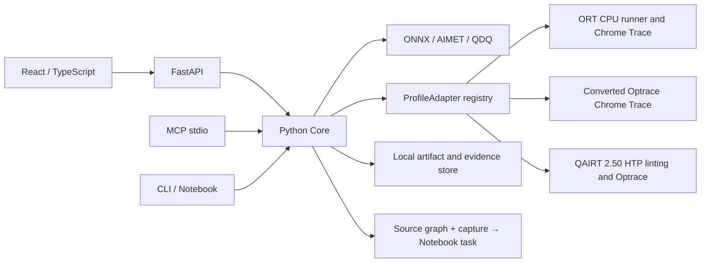

# HTP Insight 架构

## 核心对象

| 对象 | 职责 |
| --- | --- |
| ModelArtifact | 序列化模型或 Context Binary 的 SHA-256、来源、兼容性、目标设备 |
| GraphNode、SemanticModule | 张量输入与输出、依赖边、作用域识别和模块分组 |
| QuantizationInfo | Q/DQ 张量、常量 Scale、Zero Point、量化轴、位宽或 AIMET 原始编码 |
| ProfileSession、ProfileEvent | 来源、真实/导入/Fixture 标记、设备/版本、µs 或 DSP cycles、执行轨与父事件、原始 JSON 索引 |
| NodeMapping | 执行 Operation 与 ONNX 节点的多对多关系、依据和 Unknown |
| Hotspot、OptimizationHypothesis | 同一归因范围内的耗时与原始证据，以及独立的可证伪试验建议 |
| ExperimentResult | 两份 Profile、可比性判定、数值差异、结构差异和模块耗时 |

普通 ONNX 按 ONNX 节点和张量处理。Transformer 语义基于导出作用域，MobileNet 语义基于 `features.N` 与 `classifier` 作用域。无法归类的 ONNX 节点通过通用组展示。Shape inference 保留动态维的符号，无法获取的值使用 JSON null。Graph Explorer 当前遍历顶层 ONNX Graph，推断不到的 Shape 和缺失的源代码位置保持未知。Initializer elements 统计 ONNX initializers 的元素数。

## 执行、归因与存储

1. 从项目 Inbox 导入文件。外部张量路径限制在模型目录，导入后保存为自包含 ONNX。HTP Binary 仅作为透明字节流登记。
2. ORT CPU 用单线程顺序运行。关闭 graph optimization 以保留执行节点名。用独立 Session 写 Chrome Trace，另一个无 instrumentation 的 Session 用 `perf_counter_ns` 采集逐次延迟。
3. ORT adapter 匹配 `Node` 类别下的 `_kernel_time`，要求节点名称与 `op_name` 有唯一匹配。ORT 的 `node_index` 未被用作 ONNX 顺序索引。用时间包含关系挂到 `model_run`。
4. 总耗时按完整 operation 事件进行求和。未知归因保留在分母里，多节点融合事件只计一次，跨模块归因为 Shared。Trace 时间和未插桩推理的 p50、p95 各自展示。
5. 本地文件通过临时文件和原子替换发布，内容派生 ID 标识模型/输入条件/Trace 和实验。证据链接可从 UI、API、CLI 和 MCP 跳转，原始 Trace 与事件索引可独立核查。

ORT 基准比较要求相同输入摘要、设备、执行后端、版本和运行协议。输出验证检查名字、Shape、DType 和有限性，然后计算逐输出误差。浮点采用 allclose，整数使用精确等值。Baseline 和 Candidate 分别 warm up 后顺序测量。独立采集的 Trace 包含各自首轮，适合查看归因和候选解释。

## Android HTP Linting

`qnn-linting-chrome-v2.50` 解析真实设备上的 QAIRT 2.50 Linting Chrome Trace。Foreground 的操作事件按 DSP cycles 排名，Wait 和 Background 保留为时间线证据。与 Basic 的推理时间分别呈现。已有 Android 真机与 MCP/Web 验证，见 [SM6650 实测](experiments/android-sm6650.md)。

`qnn-optrace-chrome-v2.50` 读取 QAIRT Optrace 的 DSP cycles。物理轨与 QNN 算子轨可能重复，按 HTP ID、起始周期与持续周期去重。利用 `QNN Op Name` 和 DLC framework trace CSV 的明确来源名称进行多对多映射。端到端 A/B 的 Basic Profile 延迟以单独的时间口径展示。见 [Tiny Transformer 真机 A/B](experiments/android-tiny-htp-ab.md)。

## QAIRT 数据支持与扩展

| 输入或执行 | 接入边界 |
| --- | --- |
| QNN Profile 日志和 CSV | 已支持 QAIRT 2.50 viewer 的 Basic/Detailed CSV。原始 QNN log 由同版本 viewer 解码 |
| Optrace | 支持官方文档描述的转换目标 Chrome Trace 中含有 `ts` 和 `dur` 的完整事件，当前已用格式 Fixture 验证 |
| QHAS JSON、HTP Graph JSON | 支持 QAIRT JSON 1.0 作为 Profile 附件，以 HTP 原生操作 ID 关联同一轮测量 |
| 编译器辅助映射 | 当前接受本项目定义的 operation_ids / node_ids 多对多 JSON 边表 |
| HTP Binary | 支持登记、Hash、设备与兼容性元数据 |
| qnn-net-run、ADB、SSH | [本机 ADB 采集](android-runner.md) 已验证。专用 Linux 和 SSH Runner 可复用 Core 导入 |
| HMX/HVX/DMA | Timeline 预留按资源名分组，资源标注交给经过验证的解析器 |

Linux 接入沿用 `ProfileSession`、`ProfileEvent` 和归因对象。Web 和 MCP 只消费这些 Core 对象。当前工作台运行于 loopback，并假定 Inbox 中是用户信任的本地文件。

## 产品工作流和 Notebook 交接

首页按模型、采集与操作证据显示阶段可用性。能力接口查询本机 ORT CPU 提供者与已保存实测；引导实例必须来自两侧为实测、条件匹配且通过数值检查的实验。语义层按源 ONNX 已识别的层作用域归组，保留单层模型和一般 ONNX 视图。

`generate_experiment_plan` 从指定 Profile 和热点解析输入输出 Shape、映射、代表事件及匹配附件，返回同一份结构化任务和 Markdown。Fixture 跳出真实任务生成；Unknown 引导收集归因。`analyze_model_performance` 聚合源模型、实测排名、证据缺口和对应的候选任务。Web、CLI 和 MCP 复用 Core，且导出只读。采集留在显式 ORT 或 Android runner 入口。
